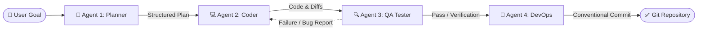

# Autonomous Multi-Agent Team Architecture

This project is powered by an autonomous 4-Agent pipeline designed to take tasks from requirement to tested, committed code with zero manual toil.

---

## The 4 Agents

### 1. [Planner & Architect Agent](file:///.agents/rules/1_planner_agent.md)
- **Role**: Breaks down the high-level objective into technical requirements, checks file impacts, and produces an execution checklist.
- **Rules File**: [.agents/rules/1_planner_agent.md](file:///.agents/rules/1_planner_agent.md)

### 2. [Developer & Coder Agent](file:///.agents/rules/2_coder_agent.md)
- **Role**: Implements clean, maintainable, production-ready code based strictly on the plan.
- **Rules File**: [.agents/rules/2_coder_agent.md](file:///.agents/rules/2_coder_agent.md)

### 3. [QA & Tester Agent](file:///.agents/rules/3_tester_agent.md)
- **Role**: Validates code correctness, runs test cases, flags edge cases, and requests fixes from the Coder if tests fail.
- **Rules File**: [.agents/rules/3_tester_agent.md](file:///.agents/rules/3_tester_agent.md)

### 4. [DevOps & Git Manager Agent](file:///.agents/rules/4_devops_agent.md)
- **Role**: Manages Git branching, resolves merge conflicts, stages changes, and writes Conventional Commits using project skills.
- **Rules File**: [.agents/rules/4_devops_agent.md](file:///.agents/rules/4_devops_agent.md)

---

## Operating Protocol
1. **Safety First**: Destructive Git operations are strictly prohibited without human confirmation.
2. **Skill Adherence**: Use `.agents/skills/` for all branch, commit, conflict, and history tasks.
3. **Continuous Verification**: Code is never committed until the QA Tester gives an explicit pass.
